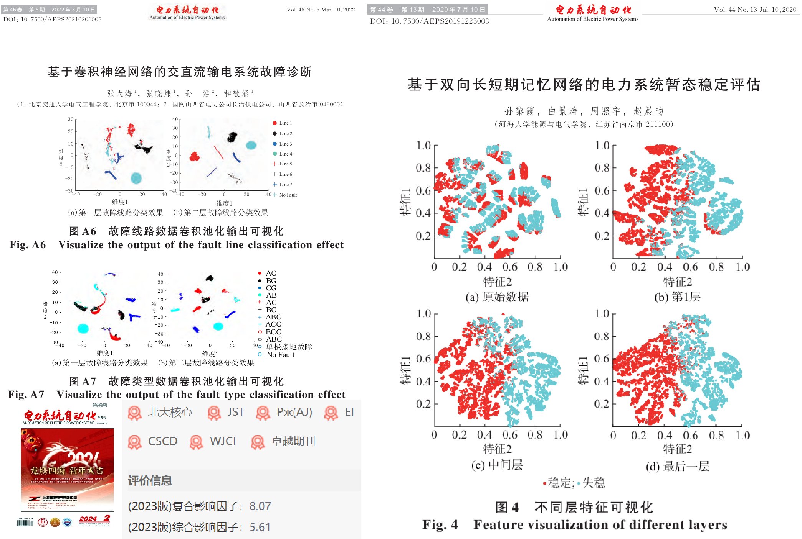
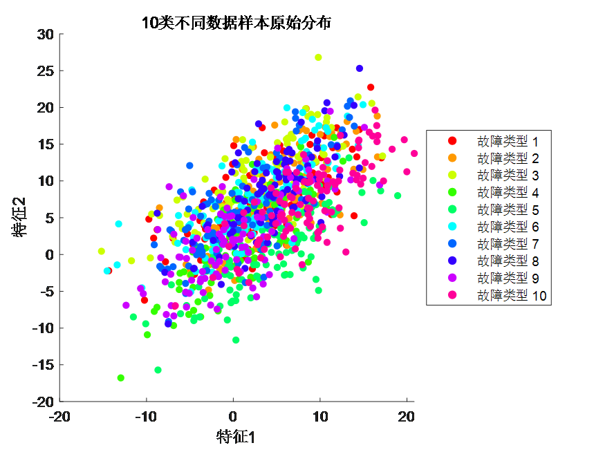
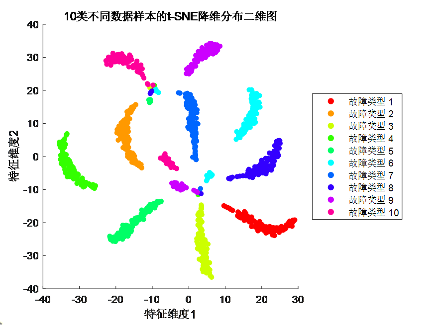
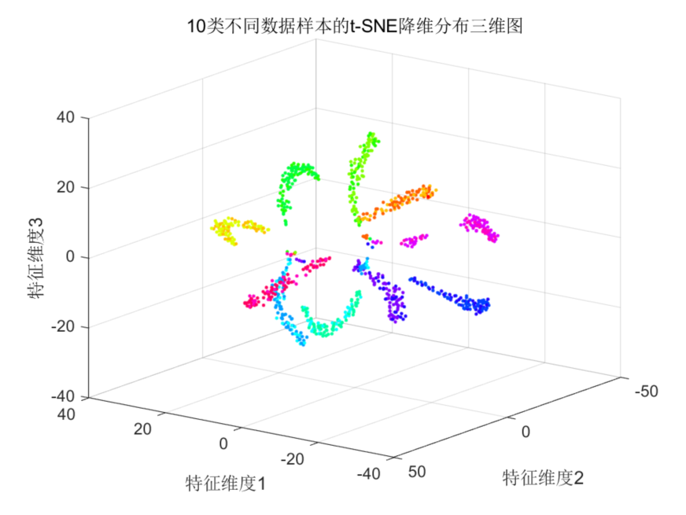
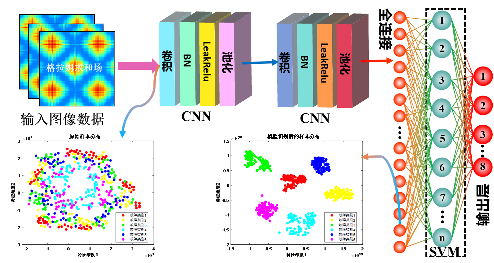
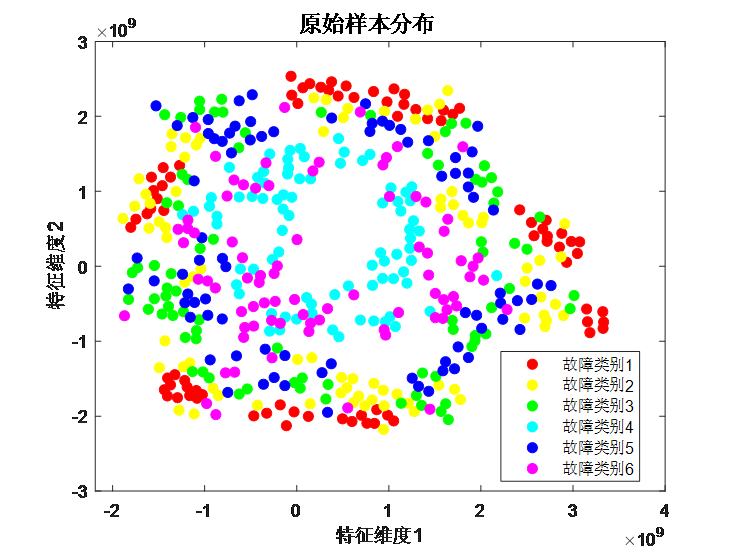
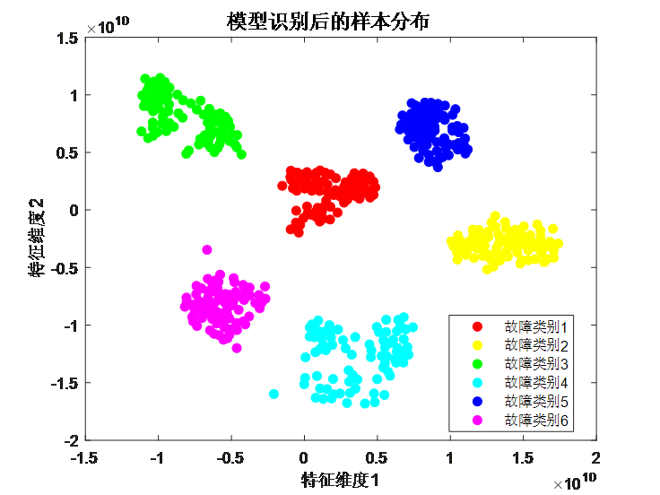

# t-SNE dimensionality reduction, essential for high-scoring SCI papers! 2 application examples, feature visualization, interpretability, deep learning fault identification, regression prediction essential tools! You won't believe it if you don't try!

Applicable Platforms: MATLAB 2021 and Above
You are certainly familiar with the feature visualization tools used in top journal papers: t-SNE; these figures are very appealing, leaving a great impression on experts and readers, making them essential tools for scientific research! Get it as soon as possible!

t-SNE Functionality: When dealing with high-dimensional data, it can be challenging to intuitively understand the relationships between data points. The goal of t-SNE is to help visualize data in a lower-dimensional space (usually 2D or 3D) while preserving the similarity relationships between data points. By performing some mathematical transformations, the original information is transformed from complex high dimensions (like 100-dimensional) into a simple distribution diagram of samples in a lower dimension (such as 2D or 3D).
Computational Steps:
The core idea of t-SNE is to maintain the similarity relationships between data points in the high-dimensional space and strive to preserve similar relationships in the lower-dimensional space. Simply put, if two points are similar in the high-dimensional space, they should still try to maintain similar relationships in the lower-dimensional space.
This algorithm's mathematical principles involve concepts of probability distribution and distance. It first calculates the similarity between points in the high-dimensional space using a probability distribution to represent this similarity. Then, in the lower-dimensional space, it calculates the similarity between points again and constructs another probability distribution.
The goal of t-SNE is to minimize the difference between these two probability distributions, ensuring that similar points in the high-dimensional space remain similar in the lower-dimensional space. This difference is usually measured using KL divergence (Kullback-Leibler divergence).
In short, t-SNE allows us to see data points in a more easily understandable lower-dimensional space while trying to preserve the similarity relationships between original data points. This makes it easier to understand the structure and patterns of data, especially in local areas.
Example 1: Visualizing High-Dimensional Data in a Lower-Dimension Space
The higher the dimensionality of data, the more challenging it is to visualize in a low-dimensional space, showing no clear patterns (scattered); when t-SNE is used to reduce dimensions to two or three dimensions, the distribution of data samples exhibits certain regularity (aggregation).

Example 2: Comparison of CNN-SVM Convolutional-Support Vector Machine Neural Network Input and Output Features
Observe the distribution of raw fault samples before input and the features extracted by the fully connected layer after model training.

Raw sample distribution: (Samples are scattered, distribution is chaotic, no obvious pattern)

Features extracted from the model: (Distinct fault samples are separated, similar fault samples are aggregated, feature extraction is successful)

Result analysis: Compared with the raw samples, the data samples after feature extraction show significant aggregation of similar samples, indicating that the CNN-SVM network model has strong feature extraction capabilities and can achieve effective fault identification.

## Images

<!-- PAYMENT_BLOCK -->

## Get this dataset

- Payment link (Stripe): [Buy now](https://buy.stripe.com/3cs8yP7sY87d0vu9AB)
- Payment QR code: 

<!-- /PAYMENT_BLOCK -->
